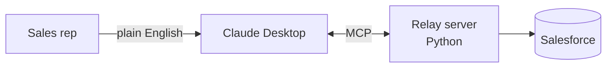

# Sahil Khan

**Technical Pre-Sales | Solutions Consulting | B2B SaaS and AI Automation**

Richardson, TX · Relocating to Los Angeles, CA (Summer 2027) · Open to remote or hybrid

[LinkedIn](https://www.linkedin.com/in/sahilhkhan) · [Email](mailto:sahiltcg@gmail.com) · [Resume (Google Doc)](https://docs.google.com/document/d/13at0mjh91jCS1trQhPJF0Zg5xHXhZ5kc0nwi7AQnXqo)

---

## About me

I am a technical pre-sales specialist in the B2B SaaS sector, working in the area that lies between the sales and product teams. At AppFolio I conduct technical discovery sessions with property managers and give demonstrations to AEs and SEs. In my personal time I develop the kind of software that I discuss with my customers, such as an AI-to-Salesforce connector, an ROI calculator, and an AI-driven business app.

I am seeking Solutions Consultant, Sales Engineer, and Technical Account Manager positions.

## Results

- In my first quarter at AppFolio I achieved **more than 200% of my quota**, holding 1,200 named SMB property-management accounts and having an 80% meeting show rate.
- Supported discovery and demos on **5 closed-won deals** for AEs and SEs
- **$2M+ in 12 months** at 139% average quarterly attainment in a full-cycle sales role
- Built AI prospecting and account-research workflows, then trained managers and BDRs to use them

## Why I'd be a good fit for a technical role

- **I earn a living by carrying out discovery work;** this involves mapping out a customer's workflows, the software they are currently using (such as Buildium, Rent Manager, and Yardi), and their pain points, after which I pass on my notes to inform the demo.
- **I understand both the buyer and the builder;** I've handled the entire process from negotiation through to delivery and have also written working code in Python, JavaScript, and REST APIs as well as OAuth.
- **I turn ideas into practical tools.** The projects listed below are live, have been tested, and are documented, not merely presented as slides.
- **I apply AI to actual workflows;** when designing and launching workflows I use Claude and the Model Context Protocol (MCP).

---

## Featured projects

### Relay: ask Claude about your Salesforce accounts in plain English

It is an MCP server which enables a sales representative to ask Claude questions such as "Summarize this account before my call" or "What's in my open pipeline?" The server provides five tools (four of which are read-only and one of which is a write tool that is closely restricted) based on the Salesforce REST API, includes injection-safe queries, has a write guardrail that applies only to demo accounts, and comes with 62 automated tests; all of the data is fictional.

**Python · Model Context Protocol · Salesforce REST API · OAuth 2.0 · pytest**
[View the project](https://github.com/SahilH-spec/relay-crm-mcp)

---

### Property ROI Calculator: a discovery-call tool for property managers

A tool which enables a property management company to see what the switch to a new platform might yield and what level of belief they would need in order for it to be worthwhile. The output focuses on the break-even point, distinguishes between actual cash savings and the time that would be freed up by the change, and either notes where each assumption comes from or states that it is my own judgment.

[Live demo](https://sahilh-spec.github.io/pm_ROI_calculator/) · [View the project](https://github.com/SahilH-spec/pm_ROI_calculator)

---

### Arbitrage Copilot: an AI-powered app for running an Amazon resale business

I created an app in order to run my own Amazon arbitrage business; each night a Claude agent researches products, evaluates them using specific criteria, and the app keeps record of the inventory, Buy Box position, and profit. The demo features fictional data.

**React · Node.js · PostgreSQL · Claude API · Amazon SP-API**
[Live demo](https://sahilh-spec.github.io/arbitrage-copilot/) · [View the project](https://github.com/SahilH-spec/arbitrage-copilot)

---

### Also built: Khushu

This is an Islamic companion app (including features such as prayer times, a Quran reader, duas, and dhikr) which uses a Raspberry Pi to play the adhan at home; it's a personal project that I use in my own household.
[Live demo](https://sahilh-spec.github.io/khushu-app/) · [View the project](https://github.com/SahilH-spec/khushu-app)

---

## Skills

| Area | Tools |
|---|---|
| Technical | Python, SQL, JavaScript/React, REST APIs, OAuth 2.0, Git/GitHub, Linux, pytest, HTML/CSS |
| AI and automation | Claude API, Model Context Protocol (MCP), prompt engineering, AI workflow design (Claude, Gemini) |
| Pre-sales | Technical discovery, demo support, requirements mapping, ROI modeling, MEDDICC, Challenger Sale |
| Tools and domain | Salesforce, Gong, Sales Navigator, Google Workspace; SaaS, PropTech, property management software |

## Education and certifications

- B.S. Computer Science (AI focus), Western Governors University, expected May 2027
- Anthropic Academy: Claude API and Intro to MCP (Oct 2026)
- LPI Linux Essentials · ITIL 4 Foundation

## Let's connect

If you're seeking someone to fill a technical pre-sales position and would like to chat, you can get in touch with me via [LinkedIn](https://www.linkedin.com/in/sahilhkhan) or by emailing [sahiltcg@gmail.com](mailto:sahiltcg@gmail.com).
