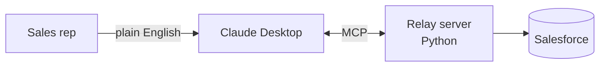

# Sahil Khan

**Technical Pre-Sales | Solutions Consulting | B2B SaaS and AI Automation**

Richardson, TX · Relocating to Los Angeles, CA (Summer 2027) · Open to remote or hybrid

[LinkedIn](https://www.linkedin.com/in/sahilhkhan) · [Email](mailto:sahiltcg@gmail.com) · [Resume (Google Doc)](https://docs.google.com/document/d/13at0mjh91jCS1trQhPJF0Zg5xHXhZ5kc0nwi7AQnXqo)

---

## About me

I am a technical pre-sales specialist in B2B SaaS, working between the sales and product teams. At AppFolio I run technical discovery with property managers and support demos for AEs and SEs. On my own time, I build the kind of software I discuss with customers: an AI-to-Salesforce connector, an ROI calculator, and an AI-driven business app.

I am seeking Solutions Consultant, Sales Engineer, and Technical Account Manager positions.

## Results

- **More than 200% of quota** in my first quarter at AppFolio, with 1,200 named SMB property-management accounts and an 80% meeting show rate
- Supported discovery and demos on **5 closed-won deals** for AEs and SEs
- **$2M+ in 12 months** at 139% average quarterly attainment in a full-cycle sales role
- Built AI prospecting and account-research workflows, then trained managers and BDRs to use them

## Why I'd be a good fit for a technical role

- **I run discovery for a living.** I map a customer's workflows, current software (such as Buildium, Rent Manager, and Yardi), and pain points, then pass my notes on to shape the demo.
- **I understand both the buyer and the builder.** I've handled the full process from negotiation through delivery, and I write working code in Python, JavaScript, and REST APIs, including OAuth.
- **I turn ideas into practical tools.** The projects below are live, tested, and documented, not just slides.
- **I apply AI to real workflows.** I use Claude and the Model Context Protocol (MCP) to design and launch them.

---

## Featured projects

### Relay: ask Claude about your Salesforce accounts in plain English

An MCP server that lets a sales rep ask Claude questions such as "Summarize this account before my call" or "What's in my open pipeline?" It provides five tools (four read-only and one tightly restricted write tool) on the Salesforce REST API, with injection-safe queries, a write guardrail limited to demo accounts, and 62 automated tests. All data is fictional.

**Python · Model Context Protocol · Salesforce REST API · OAuth 2.0 · pytest**
[View the project](https://github.com/SahilH-spec/relay-crm-mcp)

---

### Property ROI Calculator: a discovery-call tool for property managers

A tool that shows a property management company what switching to a new platform might return, and how much they would need to believe for it to be worthwhile. It focuses on the break-even point, separates real cash savings from freed-up staff time, and either cites the source of each assumption or marks it as my own judgment.

[Live demo](https://sahilh-spec.github.io/pm_ROI_calculator/) · [View the project](https://github.com/SahilH-spec/pm_ROI_calculator)

---

### Arbitrage Copilot: an AI-powered app for running an Amazon resale business

An app I built to run my own Amazon arbitrage business. Each night a Claude agent researches products and scores them against specific criteria, and the app tracks inventory, Buy Box position, and profit. The demo uses fictional data.

**React · Node.js · PostgreSQL · Claude API · Amazon SP-API**
[Live demo](https://sahilh-spec.github.io/arbitrage-copilot/) · [View the project](https://github.com/SahilH-spec/arbitrage-copilot)

---

### Also built: Khushu

An Islamic companion app (prayer times, a Quran reader, duas, and dhikr) that uses a Raspberry Pi to play the adhan at home. A personal project I use in my own household.
[Live demo](https://sahilh-spec.github.io/khushu-app/) · [View the project](https://github.com/SahilH-spec/khushu-app)

---

## Skills

| Area | Tools |
|---|---|
| Technical | Python, SQL, JavaScript/React, REST APIs, OAuth 2.0, Git/GitHub, Linux, pytest, HTML/CSS |
| AI and automation | Claude API, Model Context Protocol (MCP), prompt engineering, AI workflow design (Claude, Gemini) |
| Pre-sales | Technical discovery, demo support, requirements mapping, ROI modeling, MEDDICC, Challenger Sale |
| Tools and domain | Salesforce, Gong, Sales Navigator, Google Workspace; SaaS, PropTech, property management software |

## Education and certifications

- B.S. Computer Science (AI focus), Western Governors University, expected May 2027
- Anthropic Academy: Claude API and Intro to MCP (Oct 2026)
- LPI Linux Essentials · ITIL 4 Foundation

## Let's connect

If you're hiring for a technical pre-sales role and would like to chat, reach me on [LinkedIn](https://www.linkedin.com/in/sahilhkhan) or at [sahiltcg@gmail.com](mailto:sahiltcg@gmail.com).
