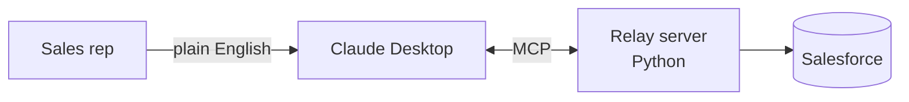

# Sahil Khan

**Account Executive | B2B SaaS and AI | Discovery, Sales Enablement, and AI Workflows**

Richardson, TX (Dallas–Fort Worth) · Open to remote

[LinkedIn](https://www.linkedin.com/in/sahilhkhan) · [Email](mailto:sahiltcg@gmail.com)

---

## About me

Quota-carrying, full-cycle closer now generating B2B SaaS pipeline at AppFolio. I run discovery-led, ROI-based sales cycles, and I build the AI workflows and tools (Python, Claude API, MCP, Salesforce API) that make sales teams faster. I also lead AI enablement for AppFolio's BDR org. I'm looking for SMB and Commercial Account Executive roles, and technical pre-sales roles, at software and AI companies.

## Results

- **$2M+ closed in 12 months** at 139% average quarterly attainment in a full-cycle sales role
- **~$100K in new business** at 100%+ of quota every month (6 for 6) in a full-cycle role
- **200%+ of quota** in my first quarter as a BDR at AppFolio, working outbound and inbound across a 1,300-account SMB territory, with an 80% meeting show rate
- Worked discovery and demos with AEs and Sales Engineers on **10 closed-won deals**
- **Lead AI enablement for the BDR org:** rolled out Claude to the Texas team, presented to 55 BDRs and 6 managers up to the BDR Director, and run recurring office hours on prompting, account research, and call prep
- Built AI prospecting and account-research workflows that surface accounts with buying signals and personalize outreach

## What I bring

- **I run discovery for a living.** I map a customer's workflows, current software (such as Buildium, Rent Manager, and Yardi), and pain points, then pass my notes on to shape the demo.
- **I understand both the buyer and the builder.** I've run the full sales cycle from discovery through negotiation and close, and I write working code in Python, JavaScript, and REST APIs, including OAuth.
- **I turn ideas into practical tools.** The projects below are live, tested, and documented, not just slides.
- **I apply AI to real workflows.** I use Claude and the Model Context Protocol (MCP) to design and launch them, then teach teams to use them.

---

## Featured projects

### Relay: ask Claude about your Salesforce accounts in plain English

An MCP server that lets a sales rep ask Claude questions such as "Summarize this account before my call" or "What's in my open pipeline?" It provides five tools (four read-only and one tightly restricted write tool) on the Salesforce REST API, with injection-safe queries, a write guardrail limited to demo accounts, and 62 automated tests. All data is fictional.

**Python · Model Context Protocol · Salesforce REST API · OAuth 2.0 · pytest**
[View the project](https://github.com/SahilH-spec/relay-crm-mcp)

---

### Property ROI Calculator: a discovery-call tool for property managers

A tool that shows a property management company what switching to a new platform might return, and how much they would need to believe for it to be worthwhile. It focuses on the break-even point, separates real cash savings from freed-up staff time, and either cites the source of each assumption or marks it as my own judgment.

[Live demo](https://sahilh-spec.github.io/pm_ROI_calculator/) · [View the project](https://github.com/SahilH-spec/pm_ROI_calculator)

---

### Arbitrage Copilot: an AI-powered app for running an Amazon resale business

An app I built to run my own Amazon arbitrage business. Each night a Claude agent researches products and scores them against specific criteria, and the app tracks inventory, Buy Box position, and profit. The demo uses fictional data.

**React · Node.js · PostgreSQL · Claude API · Amazon SP-API**
[Live demo](https://sahilh-spec.github.io/arbitrage-copilot/) · [View the project](https://github.com/SahilH-spec/arbitrage-copilot)

---

### Also built: Khushu

An Islamic companion app (prayer times, a Quran reader, duas, and dhikr) that uses a Raspberry Pi to play the adhan at home. A personal project I use in my own household.
[Live demo](https://sahilh-spec.github.io/khushu-app/) · [View the project](https://github.com/SahilH-spec/khushu-app)

---

## Skills

| Area | Tools |
|---|---|
| Sales | Full-cycle selling, outbound prospecting, inbound leads, pipeline generation, consultative discovery, demos, negotiation, ROI selling, MEDDPICC/MEDDIC, Challenger |
| Technical | Python, SQL, JavaScript/React, REST APIs, OAuth 2.0, Git/GitHub, Linux, pytest, HTML/CSS |
| AI and automation | Claude API, Model Context Protocol (MCP), prompt engineering, AI workflow design (Claude, Gemini) |
| Pre-sales and enablement | Technical discovery, demo support, requirements mapping, ROI modeling, sales enablement and training |
| Tools and domain | Salesforce, Gong, ZoomInfo, Zoom, Actively AI, Sales Navigator, Google Workspace; SaaS, SalesTech, RevTech, PropTech |

## Education and certifications

- B.S. Computer Science (AI focus), Western Governors University, expected May 2027
- Anthropic Academy: Claude API and Intro to MCP (Oct 2026)
- LPI Linux Essentials · ITIL 4 Foundation

## Let's connect

If you're hiring for an Account Executive or technical pre-sales role and would like to chat, reach me on [LinkedIn](https://www.linkedin.com/in/sahilhkhan) or at [sahiltcg@gmail.com](mailto:sahiltcg@gmail.com).
